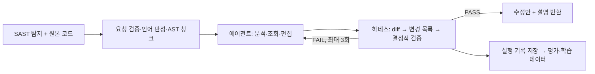

# Active Suggestion 조치 제안 파이프라인 — 생태계 기여 및 확산

> 정적 분석(SAST) 탐지 결과에 대한 코드 수정안을 오픈 LLM으로 자동 생성하고, 결정적 검증을
> 통과한 수정안만 제공하는 파이프라인의 생태계 기여 요소와 확산 방안을 정리한 문서임.
> 기술 상세는 [`pipeline_overview.md`](pipeline_overview.md) 참조.

---

## 0. 요약

- **무엇을**: SAST 탐지 1건과 원본 코드를 입력받아, 검증을 통과한 코드 수정안(`codeModifications`)과 한국어 설명을 반환하는 파이프라인
- **누가**: SAST 도구 공급사, 자체 개발 조직(CI/코드 리뷰 연동), 보안 특화 LLM을 학습하려는 연구·개발 조직
- **어떻게**: OpenAI 호환 API를 제공하는 오픈 모델 서버(9B~27B급)에 연결해 온프레미스로 운영하며, 검증기·입출력 계약·학습 데이터 생성 체계를 각각 재사용 가능

---

## 1. 배경 및 문제

- **조치 부담**: SAST는 취약점 위치를 알려주지만 수정은 개발자가 직접 해야 함. 탐지 건수가 많을수록 조치 지연과 미조치 누적이 발생
- **상용 LLM 의존과 소스 유출 우려**: 범용 상용 LLM에 수정을 맡기려면 소스코드를 외부로 전송해야 하므로 보안 민감 조직은 도입이 어려움
- **LLM 출력의 신뢰성**: LLM이 만든 수정안은 형식 오류, 엉뚱한 위치 수정, 문법 오류를 포함할 수 있어 그대로 적용하기 어려움
- **학습 데이터 부족**: 보안 취약점 수정에 특화된 모델을 학습하려 해도, 검증된 "탐지 → 수정" 쌍 데이터를 대규모로 확보하기 어려움

---

## 2. 확산 가능한 자산

| # | 자산 | 내용 | 재사용 대상 |
| --- | --- | --- | --- |
| ① | 모델 비종속 실행 하네스 | OpenAI 호환 API만 있으면 모델·서버를 바꿔 연결 가능. 오픈 모델 9B·27B급에서 동작 확인 | 온프레미스 LLM 운영 조직 |
| ② | 결정적 검증기 | LLM 없이 규칙 기반으로 수정안의 형식·적용 결과·과도 삭제·문법 오류 증가를 판정. 7개 언어 지원 | 다른 코드 생성 도구의 품질 게이트 |
| ③ | 표준 입출력 계약 | SAST 벤더에 종속되지 않는 JSON 요청·응답 형식. 변경은 `add`/`delete` 두 연산으로만 표현 | SAST 도구사, IDE·CI 연동 개발자 |
| ④ | 학습 데이터 생성 체계 | 검증 통과 수정안과 에이전트 실행 기록 전문(프롬프트·도구 호출·검증 피드백)을 행 단위로 저장 | 보안 특화 모델 학습(SFT, GRPO 등) |
| ⑤ | 평가 체계 | 요청별 성공 여부, 종료 사유, 모델 턴 수, 토큰 수, 처리 시간을 기록해 모델·설정 간 비교 가능 | 모델 선정·회귀 검증 |

### 2.1 모델 비종속 실행 하네스

- LangChain `create_agent` 기반 에이전트에 도구 3개(`read_code`, `edit_code`, `submit_fix`)만 제공
- 줄번호 계산, 변경 목록 생성, 통과 판정, 종료 제어는 하네스가 담당하므로 소형 오픈 모델로도 운영 가능
- 에이전트는 파일 저장·셸 실행 권한이 없고, 작업본은 요청별 메모리에서만 관리되어 운영 환경에 부작용이 없음
- 검증 3회, 연속 편집 실패 5회, 모델 25턴, 요청당 300초 등 상한이 있어 요청 1건의 최대 비용·시간이 정해져 있음

### 2.2 결정적 검증기

- 변경 목록 형식, 변경 간 순서·중첩, 무변경 여부, 순삭제 상한(파일의 40%, 80줄), tree-sitter 기반 문법 오류 증가 여부를 확인
- 실패 시 오류 코드와 위치·주변 코드를 돌려주므로, LLM이 아닌 다른 코드 생성 도구에도 피드백 루프로 붙일 수 있음
- 지원 언어: Java, JavaScript, TypeScript, Go, C, C++, Python

### 2.3 표준 입출력 계약

- 입력: 요청 식별자, 모델 설정, 원본 코드, 탐지 줄, 체커 설명, SAST 분석 경로(`contexts`), 위험·안전 예제
- 출력: 성공 여부, 원본 기준 줄번호의 `add`/`delete` 목록, 설명, 단계별 소요 시간. 실패 시 오류 코드(`E102`~`E999`)
- SAST 도구가 이 형식으로 탐지 결과를 내보내면 도구 종류와 무관하게 연동 가능

### 2.4 학습 데이터 생성 체계

- 동일한 하네스로 대량 배치 실행이 가능하며(동시 처리 수 지정), 요청 1건의 오류가 배치 전체를 중단시키지 않음
- 각 행에 원본 코드, 수정안, 에이전트 루프 전문(모델 응답·추론·도구 인자·검증 결과)을 함께 저장해 SFT 및 강화학습(GRPO 등) 데이터로 바로 활용 가능
- 검증 통과 여부가 행마다 기록되어 학습용 보상 신호·필터로 사용 가능

---

## 3. 지원 언어 및 대응 보안 취약점

> 이 장의 수치는 학습·평가 데이터 생성 결과(6.1·6.2절 출처와 동일)에서 집계함.
> "통과"는 결정적 검증기 PASS 기준이며, 취약점 해소 여부에 대한 의미적 평가는 별도임.

### 3.1 지원 언어

| 언어 | 확장자 | 처리 실적이 있는 체커 유형 수 | 검증 통과율 (Qwen3.8-27B, 학습셋) | 검증 통과율 (Qwen3.5-9B-GRPO, test_v4) |
| --- | --- | --- | --- | --- |
| Java | `.java` | 108 | 99.7% (55,648건) | 99.7% (314/315) |
| C | `.c`, `.h` | 124 | 94.4% (3,799건) | 98.1% (206/210) |
| C++ | `.cpp`, `.cc`, `.cxx`, `.h`, `.hpp` 등 | 128 | 98.1% (5,575건) | 99.3% (285/287) |
| Go | `.go` | 19 | 99.4% (1,010건) | 98.7% (74/75) |
| JavaScript | `.js`, `.jsx` | 37 | 97.1% (1,265건) | 98.3% (118/120) |
| TypeScript | `.ts`, `.tsx` | 23 | 93.2% (678건) | 93.3% (70/75) |
| Python | `.py` | 39 | 91.0% (2,136건) | 100.0% (149/149) |

- 언어 판정과 코드 청크 추출은 tree-sitter 문법을 사용하며, 문법 오류 증가 검사도 같은 문법으로 수행함
- 체커 유형 수는 학습·평가 데이터에 실제로 포함되어 처리된 SAST 체커 이름 기준임(Java는 학습셋, 그 외는 학습셋과 test_v4 합산)
- 평가셋 test_v4(1,231건)는 보안 체커 876건, 품질 체커 355건으로 구성되어 보안 취약점과 코드 품질 결함을 함께 다룸

### 3.2 대응 보안 취약점 유형

| 취약점 유형 | 대표 CWE (참고) | 처리 실적 언어 | 대표 체커 |
| --- | --- | --- | --- |
| SQL 삽입 | CWE-89 | Java, Go, Python | SQL Injection |
| 크로스 사이트 스크립트(XSS) | CWE-79 | Java, JS, TS, Go, Python | Cross-site scripting (ExpressJS), DOM based XSS, Cross-site Script (template) |
| 운영체제 명령·코드 삽입 | CWE-78, CWE-94 | JS, TS, Python | Command injection, Remote code execution, Script Injection |
| 경로 조작 | CWE-22 | Java, JS, Go, Python, C, C++ | Path Traversal |
| 서버 측 요청 위조(SSRF) | CWE-918 | Java, JS, Go, Python | Server-side Request Forgery |
| 신뢰되지 않은 URL 리다이렉트 | CWE-601 | Java, JS, TS | Redirection to untrusted site |
| XML 외부 개체(XXE) | CWE-611 | Java | XML External Entity Attack, Weak XML Transformer |
| 신뢰할 수 없는 데이터 역직렬화 | CWE-502 | Java, Python | Deserialization of Untrusted Data |
| 로그·HTTP 응답 분할 삽입 | CWE-117, CWE-113 | Java, JS | Log injection, HTTP Response Splitting |
| 취약한 암호 알고리즘·해시 | CWE-327, CWE-759 | Java, JS, TS, Go, Python | Weak cryptographic algorithm, Weak hash, Use of Hash without Salt, Insufficient RSA Key Length |
| 부적절한 난수 사용 | CWE-330 | 7개 언어 전체 | Use of Insufficient Random Value, Vulnerable Random Number |
| 하드코딩된 중요 정보 | CWE-798 | 7개 언어 전체 | Hardcoded sensitive information, Password Exposal in Comment, IP/Email information in source code |
| 오류·시스템 정보 노출 | CWE-209, CWE-532 | Java, Go, Python, C | Error Message Information Exposed, Exposure of system information, Logging sensitive information in Android |
| 인증서·TLS·보안 설정 미흡 | CWE-295, CWE-614 | Java, JS, TS, Go, Python | Improper TLS Settings, Weak Server Certificate, Improper Cookie Flag Setting, Improper SSH Key Settings |
| 접근 통제·권한 설정 미흡 | CWE-862, CWE-732 | Java, Go, Python | Missing login control, Incorrect Authorization for Critical Resources, Improper File Privilege Setting |
| 널 역참조·초기화 누락 | CWE-476, CWE-457 | Java, Python, C, C++ | Null dereference, Missing initialization of variable, Uninitialized value |
| 버퍼·정수·형식 문자열 오류 | CWE-120, CWE-190, CWE-134 | Java, C, C++ | Missing check of array index, Integer Overflow, Format string injection |
| 자원 누수·경쟁 조건 | CWE-772, CWE-367 | Java, C, C++ | Resource leak, TOCTOU race condition, Race Condition for Database Connection |
| 오류 처리 미흡 | CWE-252, CWE-390 | 7개 언어 전체 | Missing check of return value, Empty catch block, Improper exception handling |
| 디버그 코드 잔존 | CWE-489 | Java, JS, TS, Python, C | Debug Code Not Removed, Leftover debug code |

- C·C++는 위 보안 유형 외에 형 변환, 연산 우선순위, 중괄호 누락 등 코딩 표준 준수 항목을 다수 포함함
- CWE는 취약점 유형 이해를 돕기 위한 참고 매핑이며, 체커별 공식 매핑은 SAST 도구 문서를 따름

### 3.3 취약점 성격별 처리 방식과 실적

| 구분 | 해당 유형 | 처리 방식 | 검증 통과율 |
| --- | --- | --- | --- |
| source 필요형 | SQL 삽입, XSS, 명령 삽입, 경로 조작, SSRF, 역직렬화 등 | 분석 경로(`contexts`)의 source → sink 흐름을 코드에 대응시키고, source 차단 또는 sink 방어 위치를 결정해 수정 | 99.1% (642건) |
| source 불필요형 | 취약한 암호, 하드코딩 정보, 보안 설정, 널 역참조, 오류 처리 등 | 탐지 줄의 구문 자체를 안전한 형태로 교체 | 99.7% (5,771건) |

- 위 구분은 체커 분류표에 등록된 유형만 집계한 값임(전체 처리 건 중 6,413건). 미분류 체커를 포함한 전체 통과율은 6장 참조
- 수정 방향을 찾기 어려운 경우 체커의 안전 코드 예제 패턴을 실제 코드에 이식하는 대체 전략을 사용함

### 3.4 개선 필요 영역

통과율이 상대적으로 낮은 체커는 다음과 같음(학습셋 + test_v4 합산, 건수 40건 이상).

| 언어 | 체커 | 통과율 |
| --- | --- | --- |
| TypeScript | Cross Site Script (dangerouslySetInnerHTML) | 53.5% (43건) |
| Python | Generation of Dangerous Temp File | 81.9% (105건) |
| Python | Error Message Information Exposed | 81.9% (105건) |
| Python | Null pointer dereference | 88.0% (100건) |
| Python | Command injection | 89.5% (95건) |

- 주요 실패 원인은 검증 3회 소진, 모델 턴 상한 도달, 편집 매칭 반복 실패임
- [작성 필요: 개선 계획(체커별 프롬프트 보강, 학습 데이터 보강 등)]

---

## 4. LangChain 기반 구현

### 4.1 사용 구성 요소

| LangChain 구성 요소 | 파이프라인에서의 역할 |
| --- | --- |
| `langchain.agents.create_agent` | 모델 호출 → 도구 실행 → 모델 호출로 이어지는 에이전트 루프 구성 |
| `@tool` (langchain-core) | `read_code`, `edit_code`, `submit_fix` 도구 정의. 함수 설명과 인자로 도구 스키마를 자동 생성 |
| `AgentMiddleware` | 모델 호출 전 종료 조건 확인, 허용 도구 필터, 한 응답 한 도구 호출 강제, 도구 없는 응답 시 제출 재촉 |
| `ChatOpenAI` (langchain-openai) | OpenAI 호환 엔드포인트(vLLM, LiteLLM 등)의 오픈 모델 연결. 모델별 샘플링 설정 적용 |
| LangGraph `recursion_limit` | 그래프 스텝 상한(75스텝)으로 무한 반복 방지 |
| Callback Handler | 실행 기록 수집(모델 응답·도구 호출·검증 결과) 및 Langfuse 추적 연동 |

### 4.2 취약점 해결에 기여하는 구조

- **검증 게이트 루프**: LangChain 에이전트 루프 안에 결정적 검증기를 도구(`submit_fix`)로 넣어, 검증을 통과하지 않은 수정안은 결과로 나가지 않게 함. FAIL 시 오류 코드와 위치가 도구 결과로 돌아가 모델이 같은 루프 안에서 스스로 수정함
- **미들웨어 기반 통제**: 종료·재시도·도구 제한 정책을 프롬프트가 아닌 `AgentMiddleware`로 구현해, 모델이 지시를 따르지 않아도 정책이 강제됨
- **최소 권한 도구 구성**: `create_agent`에 넘긴 도구 3개만 등록되므로 파일 시스템·셸 접근 도구가 구조적으로 없음
- **모델 교체 용이성**: `ChatOpenAI` 인터페이스만 맞추면 모델을 교체할 수 있어, 동일 하네스로 9B·27B 및 GRPO 학습 모델을 비교·운영함

### 4.3 확장 방법

| 확장 대상 | 방법 |
| --- | --- |
| 새 언어 | tree-sitter 문법 추가 후 언어 판정표와 지원 언어 목록에 등록 |
| 새 검증 규칙 | 검증기에 규칙 추가. 에이전트 코드 변경 없이 `submit_fix` 결과에 반영 |
| 새 도구 | `@tool` 함수 작성 후 `create_agent` 도구 목록에 추가 |
| 새 실행 정책 | `AgentMiddleware` 훅(`wrap_model_call`, `after_model`)에 정책 추가 |
| 관측·평가 | LangChain Callback Handler 추가로 외부 추적 도구 연동 |

---

## 5. 활용 및 확산 시나리오

| 시나리오 | 연동 방식 | 기대 효과 |
| --- | --- | --- |
| SAST 도구 연동 | SAST 탐지 결과를 입력 계약으로 변환해 호출, 응답을 수정 제안으로 표시 | 탐지에서 조치까지 한 화면에서 처리 |
| 사내 CI·코드 리뷰 연동 | 빌드 파이프라인에서 탐지 건별로 배치 실행, 결과를 리뷰 코멘트로 게시 | 조치 리드타임 단축, 미조치 누적 감소 |
| 보안 특화 경량 모델 학습 | 학습 데이터 생성 체계로 대량 생성한 검증 통과 데이터로 9B급 모델 학습 | 소형 모델로 온프레미스 운영 비용 절감 |
| 모델 선정·회귀 검증 | 평가 체계로 후보 모델을 같은 테스트셋에 실행해 비교 | 모델 교체 시 품질 저하 사전 확인 |
| 연구·교육 | 체커별 탐지·수정 쌍과 실행 기록을 데이터셋으로 제공 | 보안 코딩 교육 자료, 연구 벤치마크 |

---

## 6. 성과 지표

> 아래 수치의 "통과"는 결정적 검증기 PASS(형식·적용·삭제 상한·문법 검증 통과)를 의미함.
> 수정이 취약점을 실제로 해소했는지에 대한 의미적 정확성 평가는 별도임.
> [작성 필요: 의미적 정확성 평가 결과(전문가 검토 또는 판정 모델 평가) 기재 여부]

### 6.1 평가셋 결과

| 평가셋 | 규모 | 모델 | 통과율 | 처리 시간 중앙값 |
| --- | --- | --- | --- | --- |
| test_v3 (7개 언어, 189개 체커) | 1,193건 | Qwen3.5-9B | 99.8% (1,191건) | 3.8초 |
| test_v4 (7개 언어, 192개 체커) | 1,231건 | Qwen3.5-9B-GRPO | 98.8% (1,216건) | 5.3초 |
| tscientific (Java·JS·TS, 4개 프로젝트, 36개 체커) | 1,657건 | Qwen3.5-9B-GRPO | 99.6% (1,650건) | 7.2초 |

test_v4 언어별 통과율:

| Java | Python | C | C++ | JavaScript | Go | TypeScript |
| --- | --- | --- | --- | --- | --- | --- |
| 314/315 | 149/149 | 206/210 | 285/287 | 118/120 | 74/75 | 70/75 |

- 요청 1건당 모델 턴 중앙값은 3턴(코드 조회 → 편집 → 제출 수준)임
- test_v3와 test_v4는 구성이 다른 평가셋이므로 두 모델의 통과율을 직접 비교하는 용도는 아님

### 6.2 학습 데이터 생성 실적

| 데이터 | 언어 | 모델 | 생성 건수 | 검증 통과 |
| --- | --- | --- | --- | --- |
| Java 학습셋 6,956건 × 8회 반복 | Java | Qwen3.5-9B | 55,648건 | 55,055건 (98.9%) |
| Java 학습셋 6,956건 × 8회 반복 | Java | Qwen3.8-27B | 55,648건 | 55,495건 (99.7%) |
| 비-Java 학습셋 전수 | C·C++·Go·JS·Python·TS | Qwen3.8-27B | 14,463건 | 13,861건 (95.8%) |
| **합계** | 7개 언어 | | **125,759건** | **124,411건** |

비-Java 학습셋 언어별 통과율: C 94.4%, C++ 98.1%, Go 99.4%, JavaScript 97.1%, Python 91.0%, TypeScript 93.2%

- 모든 행에 에이전트 실행 기록 전문이 포함되어 학습 데이터로 활용 가능
- [작성 필요: 위 데이터로 학습한 모델(예: Qwen3.5-9B-GRPO)과 학습 방식, 학습 전후 비교 결과]

### 6.3 품질 관리

- 하네스 자동 테스트 226건(LLM 호출 없이 실행) 전부 통과
- 출처: 평가셋 결과 `evals/261019`, `evals/261020`, `evals/tcientific`; 학습 데이터 `train/java/260902_train_grpo_verifier`, `evals/260918`

---

## 7. 확산 계획

| 항목 | 내용 |
| --- | --- |
| 공개 범위 | [작성 필요: 소스 공개 여부·범위(하네스, 검증기, 입출력 계약, 데이터셋)] |
| 라이선스 | [작성 필요: 적용 라이선스. 참고: 내장 AST 청킹 라이브러리 astchunk는 MIT 라이선스] |
| 공개 채널 | [작성 필요: 저장소·데이터셋 공개 위치] |
| 적용·실증처 | [작성 필요: 적용 기관·기업, 연동 SAST 도구, 적용 규모] |
| 연동 지원 | [작성 필요: 연동 가이드·샘플 제공 계획] |
| 데이터 공개 | [작성 필요: 학습·평가 데이터 공개 여부, 비식별화 방안] |
| 로드맵 | [작성 필요: 지원 언어·체커 확대, 모델 경량화, 의미적 정확성 평가 도입 일정] |
| 확산 성과 지표 | [작성 필요: 목표 지표(적용처 수, 처리 건수, 다운로드 수 등)와 목표치] |

---

## 8. 기술 요약

- **역할 분담**: 에이전트(LLM)는 무엇을 어떻게 고칠지 판단하고, 하네스는 좌표 생성·통과 판정·종료를 결정함
- **안전성**: 에이전트에게는 코드 조회·편집·제출 도구만 있고 파일 저장·셸 실행 권한은 없음
- **재사용성**: 하네스·검증기·입출력 계약·실행 기록 형식이 모델과 SAST 도구에 독립적임

상세 동작, 입출력 예시, 오류 코드, 실행 제한은 [`pipeline_overview.md`](pipeline_overview.md) 참조.
