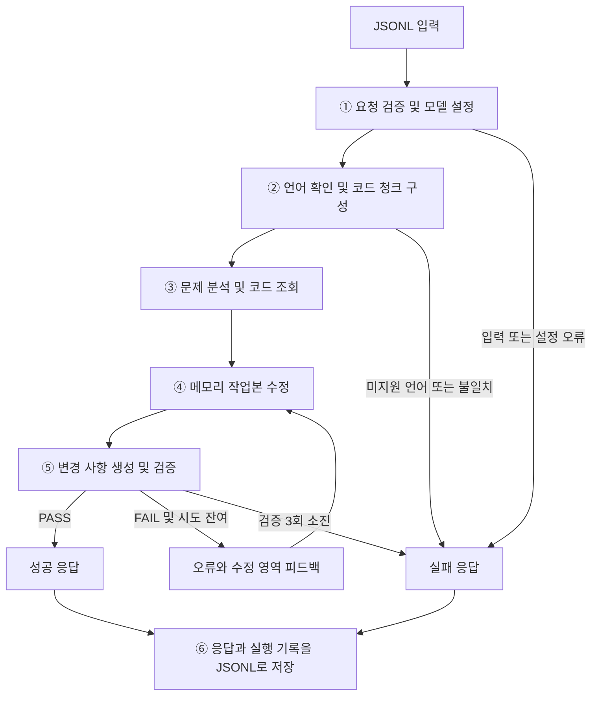

# Active Suggestion 조치 제안 파이프라인 개요

> 정적 분석(SAST)이 찾아낸 취약점과 원본 코드를 받아, LLM 에이전트가 코드를 고치고
> 결정적 검증까지 통과한 변경 사항만 돌려주는 파이프라인입니다.

---

## 1. 개요

- **입력**: SAST가 보고한 취약점 1건(취약점 유형, 탐지 줄, 분석 경로)과 해당 파일의 원본 코드
- **출력**: 원본 코드에 적용할 변경 목록(`codeModifications`)과 한국어 한 문장 설명(`desc`)

핵심 특징은 세 가지입니다.

1. **요청 단위 독립 실행** — 요청마다 별도의 작업 공간(메모리)을 쓰며, 요청 간에 상태를 공유하지 않습니다.
2. **에이전트 + 도구 3개** — LangChain `create_agent`로 만든 에이전트가 `read_code`, `edit_code`, `submit_fix` 세 도구만 사용해 수정합니다. 파일 저장이나 셸 실행 같은 다른 도구는 없습니다.
3. **판정은 하네스가 결정적으로 수행** — 수정안이 "통과"인지는 LLM이 판단하지 않습니다. 에이전트를 감싼 실행 루프(하네스)가 규칙 기반 검증기로 판정하고, 통과한 수정안만 성공 응답으로 내보냅니다.

---

## 2. 용어 정리

| 용어 | 의미 |
| --- | --- |
| SAST | 코드를 실행하지 않고 소스만 분석해 취약점을 찾는 정적 분석 도구 |
| 체커(checker) | SAST의 탐지 규칙 하나. 예: "SQL 쿼리 문자열에 외부 입력 결합" |
| 탐지 줄 | SAST가 문제로 지목한 줄 (`issueLineNumber`) |
| 분석 경로 (`contexts`) | SAST가 탐지 근거로 남긴 이벤트 목록. 각 이벤트는 줄 번호와 종류(`source`: 위험한 값이 들어오는 곳, `sink`: 위험한 값이 쓰이는 곳, `branch`: 경유 분기)를 가집니다. |
| AST 청크 | 원본 코드를 구문 트리(AST) 기준으로 메서드·클래스 단위로 자른 조각 |
| 작업본 | 에이전트가 편집하는 원본 코드의 메모리 사본. 원본은 바뀌지 않습니다. |
| 하네스 | 에이전트를 감싸 도구 제공, 실행 제한, 검증, 응답 생성을 담당하는 실행 루프 |
| `codeModifications` | 원본에 적용할 변경 목록. `add`(삽입)와 `delete`(삭제) 두 종류로만 표현합니다. |
| PASS / FAIL | 검증기 판정 결과. PASS인 수정안만 성공 응답이 됩니다. |

---

## 3. 전체 흐름



| 단계 | 수행 주체 | 내용 |
| --- | --- | --- |
| ① 요청 검증 및 모델 설정 | 하네스 | 입력 JSON의 필수 필드와 형식을 확인하고 LLM 클라이언트를 만듭니다. |
| ② 언어 확인 및 코드 청크 구성 | 하네스 | 지원 언어인지 확인하고, 탐지 줄과 분석 경로가 포함된 AST 청크를 추출합니다. |
| ③ 문제 분석 및 코드 조회 | 에이전트 | 탐지 근거를 해석하고 필요한 코드를 `read_code`로 읽습니다. |
| ④ 메모리 작업본 수정 | 에이전트 | `edit_code`로 작업본을 고칩니다. 여러 번 나눠 고칠 수 있습니다. |
| ⑤ 변경 사항 생성 및 검증 | 에이전트 → 하네스 | 에이전트가 `submit_fix`를 호출하면 하네스가 변경 목록을 만들고 검증합니다. FAIL이면 오류 내용을 에이전트에게 돌려줘 ④로 돌아갑니다. |
| ⑥ 저장 | 하네스 | 성공·실패 응답과 실행 기록을 한 줄씩 JSONL로 기록합니다. |

---

## 4. 입력

입력 파일은 JSONL이며, 한 줄이 요청 1건입니다.

| 구분 | 주요 필드 | 용도 |
| --- | --- | --- |
| 요청 식별 | `userId`, `moduleKind`, `requestIdx` | 요청과 결과 연결 |
| 모델 설정 | `model`, `provider`, `serviceHost`, `servicePort` | LLM 클라이언트 생성 (`provider`는 `openai` 호환 API만 지원) |
| 코드 | `userRequest.entireCode`, `programmingLanguage`, `fileExtension` | 원본 코드와 언어 판정 |
| 문제 정보 | `issueLineNumber`, 문제 이름·설명(`issueName*`, `issueDescription*`), `contexts` | 탐지 위치와 분석 경로 파악 |
| 참고 정보 | 위험·안전 코드 예제(`dangerousExample*`, `safeExample*`), `locale` | 수정 방향과 설명 구성 |

입력 예시(축약):

```jsonc
{
  "userId": 1,
  "moduleKind": "ActiveSuggestion",
  "requestIdx": 17,
  "model": "Qwen/Qwen3.5-9B",
  "provider": "openai",
  "serviceHost": "http://localhost/",
  "servicePort": "8080/v1",
  "userRequest": {
    "locale": "ko",
    "programmingLanguage": "Java",
    "fileExtension": ".java",
    "issueNameEn": "SQL Injection",
    "issueDescriptionEn": "External input is concatenated into a SQL query string.",
    "issueLineNumber": 42,
    "entireCode": "...파일 전체 소스...",
    "contexts": [
      { "lineNo": 38, "eventType": "source", "messageKey": "...", "message": "request parameter 'id' is read" },
      { "lineNo": 42, "eventType": "sink",   "messageKey": "...", "message": "tainted value reaches executeQuery" }
    ],
    "dangerousExampleEn": "stmt.executeQuery(\"SELECT * FROM t WHERE id=\" + id);",
    "safeExampleEn": "PreparedStatement ps = conn.prepareStatement(\"SELECT * FROM t WHERE id=?\");\nps.setString(1, id);"
  }
}
```

---

## 5. 처리 단계 상세

### 5.1 요청 검증과 모델 설정

- 입력 JSON을 스키마로 검증합니다. 필수 필드가 없거나, `issueLineNumber`가 코드 전체 줄 수를 넘으면 실패 응답(`E102`)을 냅니다.
- LLM 접속 주소는 `serviceHost` + `servicePort`로 만듭니다. 실행 시 `--base-url`을 주면 그 값이 우선합니다. 주소를 만들 수 없거나 `provider`가 지원 대상이 아니면 실패 응답(`E104`)을 냅니다.

### 5.2 언어 판정과 AST 청크 추출

- 지원 언어는 **Java, JavaScript, TypeScript, Go, C, C++, Python** 7개입니다.
- `fileExtension`과 `programmingLanguage`로 언어를 판정합니다. 미지원 언어이거나 둘이 서로 맞지 않으면 모델을 호출하지 않고 실패 응답(`E103`)을 냅니다.
- 원본 코드를 AST 청크로 나눈 뒤, **탐지 줄**과 **`contexts`의 모든 이벤트 줄**을 포함하는 청크만 골라냅니다. 이렇게 하면 에이전트가 처음부터 문제 지점 주변의 메서드·클래스 구조를 볼 수 있습니다.

### 5.3 초기 메시지 구성

에이전트가 받는 첫 메시지는 다음 순서로 구성됩니다. 값이 없는 섹션은 생략합니다.

1. 작업 지시 — "N번 줄의 SAST 탐지를 수정하라"와 파일 전체 줄 수
2. 문제 메타데이터 — 언어, 탐지 줄, 위험도, 문제 이름 등 (JSON)
3. 체커 설명
4. 분석 경로(`contexts`) (JSON)
5. 대상 코드 청크 — 줄번호가 붙은 AST 청크
6. 위험 코드 예제 / 안전 코드 예제

설명과 예제는 영문이 있으면 영문을, 없으면 한국어를 씁니다.

### 5.4 에이전트 수정 루프

에이전트는 다음 원칙으로 수정합니다.

- **탐지 결과는 실제 취약점으로 간주합니다.** "오탐으로 보인다"는 이유로 수정을 거부하지 않습니다.
- 분석 경로를 해석해 문제 유형을 구분합니다.
  - **source 불필요형**: 탐지 줄 자체가 결함인 경우(예: 위험한 API 호출). 해당 줄을 직접 고칩니다.
  - **source 필요형**: 외부 입력(source)이 위험 지점(sink)까지 흘러가는 경우. 경로를 따라가 source에서 차단할지 sink에서 방어할지 정합니다.
- 동작을 바꾸지 않는 **최소 수정**을 목표로 합니다. 마땅한 수정 방법이 없으면 안전 예제의 패턴을 실제 코드에 옮겨 적용합니다.

에이전트가 쓰는 도구는 세 가지입니다. 세 도구는 같은 작업본을 공유합니다.

| 도구 | 역할 |
| --- | --- |
| `read_code(offset, limit)` | 현재 작업본을 줄번호와 함께 조회합니다. `offset`은 0부터 시작하며, 기본 100줄, 한 번에 최대 2000줄까지 읽습니다. |
| `edit_code(old_string, new_string)` | 작업본에서 `old_string`과 정확히 한 곳만 일치하는 부분을 `new_string`으로 치환합니다. 여러 번 호출해 편집을 누적할 수 있습니다. |
| `submit_fix(desc)` | 원본과 작업본의 차이로 변경 목록을 만들어 검증합니다. `desc`는 수정 내용을 설명하는 한국어 한 문장(300자 이하)입니다. |

알아둘 점:

- 에이전트는 줄번호나 `codeModifications`를 직접 만들지 않습니다. 에이전트는 작업본만 고치고, **하네스가 원본과 작업본의 diff에서 변경 목록을 생성**합니다. 덕분에 좌표 계산 실수가 구조적으로 생기지 않습니다.
- `edit_code`가 일치하는 곳을 찾지 못하거나 여러 곳과 일치하면 오류를 돌려줍니다. 이 실패는 검증 횟수를 차감하지 않습니다.
- 편집 없이 `submit_fix`를 호출하면 오류를 돌려주며, 이때도 검증 횟수를 차감하지 않습니다.

### 5.5 검증 항목

`submit_fix`가 호출되면 하네스가 아래 항목을 순서대로 확인합니다. 하나라도 걸리면 FAIL이며, 오류 코드와 메시지, 수정된 영역(새 줄번호 기준 앞뒤 3줄)을 에이전트에게 돌려줍니다.

| 단계 | 확인 내용 | 오류 코드 예 |
| --- | --- | --- |
| 설명 | `desc`가 비어 있지 않고 300자 이하인 한국어 한 문장인지 | `V101`, `V102`, `V110` |
| 형식 | 변경 목록의 타입·필수 필드·줄 범위가 올바른지 | `V103`~`V112` |
| 구조 | 변경들이 줄 순서대로 정렬되어 있고 서로 겹치지 않는지 | `V201` |
| 적용 결과 | 원본에 적용한 결과가 원본과 달라졌는지(무변경 금지) | `V301`, `V303` |
| 과도한 삭제 | 순삭제가 파일의 40% 이하이고 80줄 이하인지 | `V302` |
| 문법 | 수정 후 문법 오류가 원본보다 늘지 않았는지 (tree-sitter 파서로 비교) | `V401` |

문법 오류(`V401`)가 나면 오류 위치와 주변 코드를 메시지에 함께 담아, 에이전트가 어디를 고쳐야 할지 알 수 있게 합니다.

**PASS는 최종 판정입니다.** PASS가 나오면 그 수정안을 바로 채택하고 루프를 끝냅니다. 별도의 사후 검토 단계는 없습니다.

---

## 6. 출력

### 6.1 성공 응답

```jsonc
{
  "isSuccess": true,
  "userId": 1,
  "moduleKind": "ActiveSuggestion",
  "requestIdx": 17,
  "desc": "외부 입력을 문자열로 결합하던 쿼리를 PreparedStatement 바인딩으로 변경합니다.",
  "codeModifications": [
    { "type": "delete", "startLine": 42, "endLine": 42 },
    { "type": "add", "startLine": 42,
      "content": "        PreparedStatement ps = conn.prepareStatement(\"SELECT * FROM t WHERE id=?\");\n        ps.setString(1, id);\n        ResultSet rs = ps.executeQuery();" }
  ],
  "timings": {
    "explore_elapsed_time": 0.0,
    "fix_elapsed_time": 12.4,
    "select_elapsed_time": 0.0,
    "graph_elapsed_time": 12.6
  }
}
```

`codeModifications` 해석 규칙:

- 줄번호는 모두 **원본 코드 기준**(1부터 시작)입니다.
- `delete`: `startLine`부터 `endLine`까지 삭제합니다.
- `add`: 원본의 `startLine`번 줄 앞에 `content`를 삽입합니다. 여러 줄은 `\n`으로 구분합니다.
- **치환**은 `delete` 다음에 같은 `startLine`의 `add`를 두어 표현합니다(위 예시).
- 가까운 변경(5줄 미만 간격)은 하나의 연속된 치환으로 합칩니다.

`timings`의 `fix_elapsed_time`은 에이전트 루프와 검증에 걸린 시간, `graph_elapsed_time`은 요청 1건의 전체 처리 시간(초)입니다. 나머지 두 값은 이 파이프라인에서 항상 0입니다.

### 6.2 실패 응답

실패 시에는 `isSuccess: false`와 함께 오류 정보가 붙고, `codeModifications`는 빈 목록입니다.

```jsonc
{
  "isSuccess": false,
  "userId": 1,
  "moduleKind": "ActiveSuggestion",
  "requestIdx": 17,
  "desc": "",
  "codeModifications": [],
  "errorCode": "E301",
  "errorStage": "select",
  "errorNode": "fix_branch",
  "errorType": "GenerationError",
  "errorMessage": "verification failed after 3 attempt(s) (budget_exhausted); last errors: ..."
}
```

| 오류 코드 | 단계 | 원인 |
| --- | --- | --- |
| `E102` | input | 입력 JSON 스키마 오류 |
| `E103` | input | 미지원 언어, 또는 언어명과 확장자 불일치 |
| `E104` | input | 모델 설정 오류 (접속 주소 생성 불가, 미지원 provider) |
| `E202` | fix | LLM 서버 연결·호출 실패 |
| `E301` | select | 검증을 통과한 수정안을 만들지 못함 (검증 횟수 소진, 편집 실패 반복, 시간 초과 등) |
| `E999` | output | 그 밖의 내부 오류 |

LLM 호출 중 오류가 나더라도 그 전에 PASS를 받은 수정안이 있으면 성공 응답으로 내보냅니다.

---

## 7. 실행 제한과 종료 조건

에이전트가 끝없이 반복하지 않도록 하네스가 아래 제한을 둡니다. 제한에 걸리면 하네스가 루프를 종료하고, PASS 수정안이 없으면 실패 응답(`E301`)을 냅니다.

| 항목 | 현재 제한 | 걸렸을 때 |
| --- | --- | --- |
| 검증 시도 | 요청당 최대 3회 | 3회 모두 FAIL이면 종료 |
| 연속 편집 실패 | 5회 연속 실패 시 종료 (편집이 한 번 성공하면 횟수 초기화) | 일치하는 편집을 만들지 못한 것으로 종료 |
| 도구 호출 없는 응답 | 검증 시도가 남아 있으면 `submit_fix` 호출을 최대 2회 재촉 | 재촉 후에도 도구를 호출하지 않으면 종료 |
| 한 응답에 여러 도구 호출 | 허용하지 않음 (한 번에 도구 하나) | 프로토콜 오류로 즉시 종료 |
| 전체 루프 | 모델 25턴 기준, 그래프 75스텝 | 스텝 상한에 도달하면 종료 |
| 실행 시간 | 기본 300초. 매 모델 호출 전에 확인. CLI에서 변경 가능 | 기한을 넘기면 다음 호출 전에 종료 |
| 개별 LLM 호출 | 호출당 타임아웃 90초 | 호출 실패로 처리 (`E202`) |

---

## 8. 처리 예시: 요청 1건 따라가기

아래는 4장의 SQL Injection 요청이 처리되는 과정을 단순화한 예시입니다.

1. **요청 검증** — 스키마가 올바르고, `.java`이므로 언어는 Java로 판정합니다.
2. **청크 추출** — 탐지 줄(42)과 source 이벤트 줄(38)이 속한 메서드 청크를 골라 초기 메시지에 넣습니다.
3. **분석** — 에이전트는 `contexts`에 source와 sink가 모두 있으므로 "source 필요형"으로 분류합니다. 38번 줄에서 읽은 요청 파라미터 `id`가 42번 줄 쿼리 문자열에 결합된다고 해석합니다.
4. **조회** — 메서드 밖에서 `conn` 선언을 확인하려고 `read_code(offset=0, limit=120)`을 호출합니다.
5. **편집** — `edit_code`로 42번 줄의 문자열 결합 쿼리를 `PreparedStatement` 바인딩으로 바꿉니다.
6. **1차 제출 → FAIL** — `submit_fix`를 호출했지만 `PreparedStatement` 선언 줄 끝에 `;`가 빠져 문법 오류가 늘었습니다. 하네스는 `V401`과 함께 오류 위치(43번 줄, 누락 토큰 `;`)와 주변 코드를 돌려줍니다. (남은 시도 2회)
7. **수정** — `edit_code`로 빠진 `;`를 채웁니다.
8. **2차 제출 → PASS** — 하네스가 변경 목록(42번 줄 `delete` + `add`)을 만들어 검증을 통과하고, 성공 응답을 생성합니다.
9. **저장** — 응답과 실행 기록(모델 턴 수, 토큰 수, 시도별 오류, 종료 사유 `pass`)을 출력 JSONL에 한 줄로 기록합니다.

---

## 부록. 실행 방법

```bash
cd deepagents_pipeline && uv sync

.venv/bin/python -m deepagents_pipeline.runner \
  --input  input.jsonl \
  --output out.jsonl \
  [--indices 0,1,2] \
  [--base-url http://localhost:8080/v1] \
  [--model-override Qwen/Qwen3.5-9B] \
  [--wall-clock-seconds 300] \
  [--concurrency 5]
```

| 옵션 | 설명 |
| --- | --- |
| `--input` / `--output` | 입력·출력 JSONL 경로 |
| `--indices` | 처리할 `requestIdx`를 쉼표로 지정 (기본: 전체) |
| `--base-url` | LLM 접속 주소. 요청의 `serviceHost`/`servicePort`보다 우선 |
| `--model-override` | 요청의 `model` 대신 사용할 모델명 |
| `--wall-clock-seconds` | 요청 1건당 실행 시간 제한 (기본 300초) |
| `--concurrency` | 동시에 처리할 요청 수 (기본 1) |

- API 키는 요청의 `APIKEY` → 환경변수 `LITELLM_MASTER_KEY` → `"EMPTY"` 순으로 사용합니다.
- 출력 각 줄에는 응답(`response`) 외에 성공 여부(`passed`), 종료 사유(`terminal_cause`), 모델 턴 수, 입출력 토큰 수, 처리 시간, 도구 호출 기록이 함께 저장됩니다.
- 요청 1건에서 오류가 나도 해당 줄만 실패 응답으로 기록하고 나머지 요청은 계속 처리합니다.
